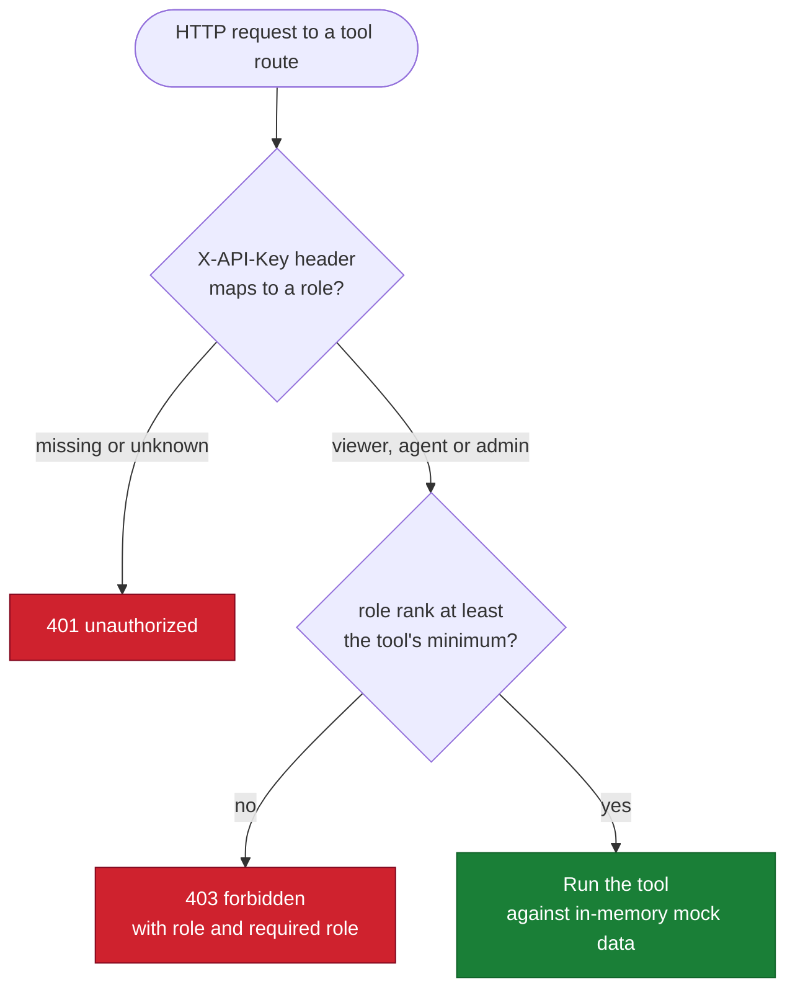

# mcp-rbac-demo

<p>
  
  
  
  
</p>

A tool server for LLM agents that checks the caller's role on every call, against mock ticketing, documentation and quoting data.

## The problem

When a language model can call tools, the tool server is the only thing standing between a prompt and the systems behind it. The model chooses which tools to call and in what order, so there is no designed flow and no natural point at which "the session began." Authorization has to happen on each call, and a caller without valid credentials has to get nothing.

This repository is a small, runnable version of that pattern: a Flask server exposing four tools, an API key per caller, three ranked roles, and a check on every request that the caller's role is high enough for the tool. It is the runnable companion to [decision 0005](https://github.com/Jaswanthnani02/client-intelligence-platform/blob/main/docs/decisions/0005-per-call-authorization.md) in the [client-intelligence-platform](https://github.com/Jaswanthnani02/client-intelligence-platform) case study, and implements the role half of that decision. The table under [Scope](#scope-against-decision-0005) says exactly which parts.

"MCP-style" means the shape, not the wire protocol: named tools with descriptions, a discovery endpoint filtered by role, and one route per tool. It is plain HTTP and JSON, not the Model Context Protocol's JSON-RPC transport.

## How a call is authorized



The check is a decorator, `require_auth(min_role)`, applied to every route except `/health`. Nothing is cached between requests: the key is resolved to a role and compared against the tool's minimum on each call.

## Roles and tools

Roles are ranked `viewer` (1) < `agent` (2) < `admin` (3). A role can call every tool at or below its rank.

| Tool | Method and route | Minimum role | What it does |
|---|---|---|---|
| `list_tickets` | `GET /tools/list_tickets` | viewer | Returns the two mock tickets |
| `get_doc` | `GET /tools/get_doc?id=vpn-reset` | viewer | Returns a mock documentation article, 404 for an unknown id |
| `update_ticket` | `POST /tools/update_ticket` | agent | Sets a ticket's status in memory |
| `create_quote` | `POST /tools/create_quote` | admin | Returns a mock quote for the given account and amount |

`GET /tools` returns only the tools the caller's role can use, so an agent asking "what can I do" never sees a tool it would be refused.

Demo keys, hardcoded in `server.py` for illustration only: `viewer-key`, `agent-key`, `admin-key`.

## Quickstart

Verified with Python 3.13 and Flask 3.1. Runs entirely on localhost; no network access or external services.

```bash
python -m venv .venv
source .venv/bin/activate          # Windows: .venv\Scripts\activate
python -m pip install -r requirements.txt
python server.py                   # serves on http://127.0.0.1:8787
```

In a second terminal:

```bash
# No key: rejected
curl -s http://127.0.0.1:8787/tools/list_tickets

# What can a viewer see?
curl -s -H "X-API-Key: viewer-key" http://127.0.0.1:8787/tools

# Viewer reads tickets: allowed
curl -s -H "X-API-Key: viewer-key" http://127.0.0.1:8787/tools/list_tickets

# Viewer updates a ticket: forbidden
curl -s -H "X-API-Key: viewer-key" -X POST http://127.0.0.1:8787/tools/update_ticket \
  -H "Content-Type: application/json" -d '{"ticket_id":"TCK-1","status":"Closed"}'

# Agent updates a ticket: allowed
curl -s -H "X-API-Key: agent-key" -X POST http://127.0.0.1:8787/tools/update_ticket \
  -H "Content-Type: application/json" -d '{"ticket_id":"TCK-1","status":"Closed"}'

# Agent creates a quote: forbidden. Admin: allowed
curl -s -H "X-API-Key: agent-key" -X POST http://127.0.0.1:8787/tools/create_quote \
  -H "Content-Type: application/json" -d '{"account":"Acme","amount":1200}'
curl -s -H "X-API-Key: admin-key" -X POST http://127.0.0.1:8787/tools/create_quote \
  -H "Content-Type: application/json" -d '{"account":"Acme","amount":1200}'
```

## Example output

Responses from a run of the commands above, in order, each prefixed with its HTTP status:

```text
401  {"error":"unauthorized","hint":"Send X-API-Key"}
200  {"role":"viewer","tools":[{"description":"List open tickets from the mock PSA API","method":"GET","min_role":"viewer","name":"list_tickets"},{"description":"Fetch a documentation article from the mock knowledge base (IT Glue\u2013style)","method":"GET","min_role":"viewer","name":"get_doc"}]}
200  {"tickets":[{"id":"TCK-1","status":"Open","summary":"VPN down"},{"id":"TCK-2","status":"Open","summary":"Mailbox full"}]}
403  {"error":"forbidden","required":"agent","role":"viewer"}
200  {"ok":true,"ticket":{"id":"TCK-1","status":"Closed","summary":"VPN down"}}
403  {"error":"forbidden","required":"admin","role":"agent"}
200  {"account":"Acme","amount":1200,"ok":true,"quote_id":"Q-1001"}
```

A refusal names both the caller's role and the role the tool requires, so an agent or a person reading the log can see why without guessing.

## Scope against decision 0005

Decision 0005 describes a production authorization model with two axes and two authentication paths. This demo implements part of it.

| Element of decision 0005 | In this demo |
|---|---|
| Authorize every call, with no session-level cache | Yes. The decorator resolves and checks the key on every request. |
| Fail closed when there is no valid credential | Yes. A missing or unknown key returns 401 before any tool code runs. |
| Role axis: which tools a caller may use | Yes. Three ranked roles, enforced per route. |
| Discovery filtered by role | Yes. `GET /tools` lists only what the caller can call. |
| Second authentication path (bearer token validated against a directory) | No. API keys only. |
| Tenant axis: which clients a caller may see | No. Every authorized caller sees the same mock data. |
| A tool with no assigned tier defaults to the highest tier | No. Each route states its minimum role explicitly. |

## Limitations

- **Two declarations of each tool's minimum role.** The `TOOLS` registry drives what `GET /tools` shows; the `@require_auth(...)` decorator on each route drives what is enforced. They agree today, but nothing asserts that they do. A test comparing the two is the obvious next step.
- **Keys are hardcoded** in `server.py`. A real deployment reads them from a secret store and does not ship them in source.
- **State is in memory.** `update_ticket` changes persist until the server restarts.
- **Flask's development server**, bound to `127.0.0.1`. Not intended for deployment.

## Project structure

| File | Purpose |
|---|---|
| [`server.py`](server.py) | Flask app: key-to-role map, tool registry, `require_auth` decorator, four tool routes, `/tools` discovery and `/health` |
| [`requirements.txt`](requirements.txt) | `flask>=3.0.0` |

## Related

- [client-intelligence-platform](https://github.com/Jaswanthnani02/client-intelligence-platform): the architecture case study this pattern comes from, including [decision 0005](https://github.com/Jaswanthnani02/client-intelligence-platform/blob/main/docs/decisions/0005-per-call-authorization.md) on per-call authorization
- [ticket-dispatcher-demo](https://github.com/Jaswanthnani02/ticket-dispatcher-demo): round-robin and weighted-load ticket assignment against a mock PSA API
- [doc-link-check](https://github.com/Jaswanthnani02/doc-link-check): verifies that every relative link in a project's Markdown resolves

Built by [Jaswanth Gaddam](https://github.com/Jaswanthnani02). More at [jaswanthnani02.github.io](https://jaswanthnani02.github.io).
